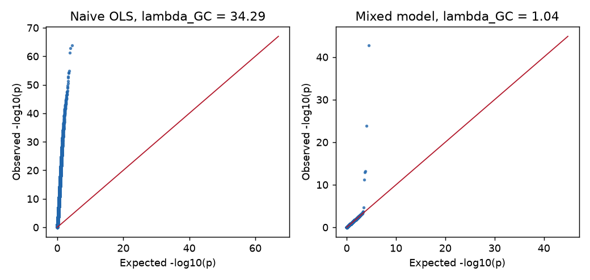
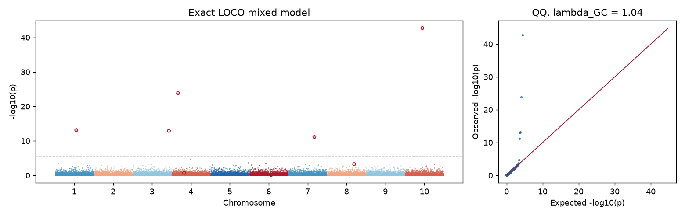
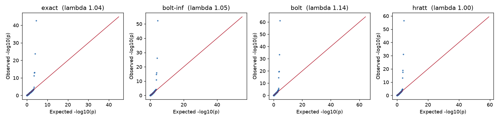

# mixmogam tutorial

One simulated structured population, analysed from start to finish. Every
number and figure below comes from
[`tutorial/tutorial.py`](tutorial/tutorial.py), which runs in about a minute on
a laptop (the two mixture/elastic-net fits take ~20 s each):

```sh
OPENBLAS_NUM_THREADS=1 OMP_NUM_THREADS=1 python docs/tutorial/tutorial.py
```

The [quickstart](quickstart.md) lists the options and the
[research report](../report/README.md) gives the evidence for each method.

## 1. A structured population with known answers

1,500 samples from 5 diverged subpopulations (Fst scale 0.35), 15,000 variants
on 10 chromosomes, and a trait with heritability 0.6: half infinitesimal
polygenic background, half from 8 true QTL. Ancestry shifts both genotype
and trait, which is what makes association hard here.

```python
import numpy as np
from mixmogam import Genotypes, gwas
from mixmogam.simulate import simulate_genotypes, simulate_traits

G = simulate_genotypes(n=1500, m=15000, n_pop=5, pop_fst=0.35, seed=11)   # (m, n)
gt = Genotypes(G.T, chromosome=np.repeat(np.arange(1, 11), 1500),
               position=np.tile(np.arange(1500) * 1000, 10))
sim = simulate_traits(G, h2=0.6, n_causal=8, seed=12)
y = sim["y"]
```

With real data you would instead use `Genotypes.load_plink(prefix)`,
`read_phenotypes(...).complete("trait")`, `gt.align_samples(samples)` and
`gt.filter_variants(min_mac=5, max_missing=0.1)`; see the quickstart.

## 2. Why a mixed model

Per-SNP linear regression ignores relatedness, and structure wrecks it:

| | λ_GC | Bonferroni hits (15,000 tests) |
|---|---|---|
| Naive OLS | 34.3 | 6,380 |
| Mixed model (`gwas`) | 1.04 | 5, all within 10 SNPs of a true QTL |



## 3. The headline call

```python
result = gwas(y, gt)             # n <= 5000 -> method="exact": EMMAX, REML refit per LOCO group
result.genomic_control()         # 1.042
result.extra["pseudo_heritability"]   # per LOCO group: 0.49 – 0.63 (truth 0.6)
result.top_snps(5)               # a GwasResult, smallest p first
result.write_csv("gwas.csv")
```

By default each SNP is tested against a polygenic model built without its
own chromosome (leave-one-chromosome-out), so the SNP cannot absorb itself
into the kinship (proximal contamination). The top hits:

| chr | position | p | β | se |
|---|---|---|---|---|
| 10 | 674000 | 1.8e-43 | −0.536 | 0.038 |
| 4 | 243000 | 1.5e-24 | +0.368 | 0.035 |
| 1 | 830000 | 7.2e-14 | +0.273 | 0.036 |
| 3 | 1414000 | 1.2e-13 | +0.254 | 0.034 |
| 7 | 1017000 | 7.1e-12 | +0.257 | 0.037 |

```python
from mixmogam.plotting import plot_manhattan, plot_qq
plot_manhattan(result, highlight=causal_indices)   # red rings = true QTL
plot_qq(result.p)
```



Five of the eight QTL clear Bonferroni. The other three have small simulated
effects (−log10 p of 0.1–3.3), and no method below finds them either.

## 4. One entry point, four engines

`method=` switches the statistical engine; the input and output stay the same.

```python
for method in ["exact", "bolt-inf", "bolt", "hratt"]:
    r = gwas(y, gt, method=method)
```

| method | time | λ_GC | Bonferroni hits | QTL found | hits far from a QTL |
|---|---|---|---|---|---|
| `exact` | 2.3 s | 1.042 | 5 | 5/8 | 0 |
| `bolt-inf` | 1.0 s | 1.051 | 5 | 5/8 | 0 |
| `bolt` | 20.5 s | 1.136 | 6 | 6/8 | 0 |
| `hratt` | 20.6 s | 0.999 | 5 | 5/8 | 0 |



- `exact` is the reference at this size, and `method="auto"` picks it up to
  5,000 samples (`bolt-inf` above). The other engines avoid the O(n³)
  factorizations and use less memory, which pays only at larger n; at
  n = 1,500 they are slower.
- `bolt` and `hratt` give larger −log10 p at the QTL than `exact` (57-61 vs 43
  at the strongest one). Part of that may be power from a non-infinitesimal
  prior, but the statistics also differ (retrospective score tests against an
  F test), so compare calls and calibration rather than raw p-values.
- Both `bolt` and `hratt` warned "variational fit did not converge" here
  (`result.extra["cv_converged"]` and `["loco_converged"]` are `False`), and
  `bolt` has the highest λ (1.14). The cause is the five populations the model
  was not adjusted for: on a 3,000-variant version of this panel both
  converged once the covariates included K - 1 = 4 principal components (the
  15,000-variant run was not repeated). Check those flags before trusting a
  two-step fit.
- 6/8 for `bolt` against 5/8 is one SNP in one simulation; the matched
  benchmarks are in the report.

## 5. Case-control outcomes and sampling weights

Only HRATT models binary traits and weighted samples. Here the top 20% of the
liability are cases. Under structure, include ancestry PCs, because the score
test models allele frequencies from the covariates:

```python
K = kinship.realized_relationship(gt)             # for MLMM and LMM below
pcs = principal_components(gt, k=4)               # built-in ancestry PCs
rb = gwas(y01, gt, X=pcs, method="hratt", trait="binary")
rw = gwas(y,   gt, X=pcs, method="hratt", sample_weights=w)   # e.g. 1/P(participation)
```

`mixmogam pca --geno prefix --k 4 --out pcs.txt` writes these as a
covariate file, and `mixmogam gwas ... --covar pcs.txt` (or `--pcs 4`)
uses them without Python.

| | λ_GC | Bonferroni hits | far from a QTL |
|---|---|---|---|
| Binary, 20% prevalence, with PCs | 0.99 | 4 | 0 |
| Weighted (design effect 1.06), with PCs | 1.03 | 5 | 0 |

Without PCs the binary trait gave λ_GC = 1.83, with a "strong population
structure remains" warning. Binary `beta` is a one-step log-odds
approximation, exported as `beta_one_step`, not a fitted logistic
coefficient. These paths are experimental; the README summarizes where their
validation fell short.

## 6. From signals to independent loci: stepwise MLMM

Genome-wide scans report peaks, not independent effects. `mlmm` adds the
strongest SNP as a cofactor, refits the mixed model, and repeats, then prunes
backwards:

```python
from mixmogam.stepwise import mlmm
out = mlmm(y, gt, K=K, max_steps=8)
out["selected"]["ebic"]     # [830, 4414, 4743, 10017, 14174]
```

True QTL indices: 830, 4414, 4743, 4983, 8343, 10017, 11551, 14174. The
extended-BIC and multiple-Bonferroni rules both select 5 of them with no false
cofactors; plain BIC adds three more, one true (11551) and two not (9650,
12899). The pseudo-heritability in `out["steps"]` falls from 0.60 to 0.35 as
the cofactors take over variance the kinship was carrying, a multi-locus
picture the single-SNP scan cannot give.

## 7. Heritability and a permutation threshold

```python
from mixmogam import LMM
fit = LMM(y, K=K).fit()
fit.pseudo_heritability            # 0.603 (simulated h² = 0.6)

from mixmogam.scan import permutation_min_p
permutation_min_p(fit, gt, n_perm=200)["threshold_05"]   # 4.25e-06
```

The 5% permutation threshold (4.3e-6, rough with 200 permutations) sits near
Bonferroni (3.3e-6), as expected with mostly independent SNPs. With dense,
correlated markers it would be less strict than Bonferroni, which is when it
earns its cost. The current permutation scheme has not yet had a large
validation.

## 8. Scaling: threads and two-bit genotypes

```python
Genotypes(G.T, chromosome=..., position=..., packed=True)   # 2 bits per call
gwas(y, gt, method="hratt", n_threads=4)                    # `fast` extra, set BLAS threads to 1 first
```

Packed storage takes a quarter of the int8 memory and gives identical
results; the script checks this on the HRATT scan (maximum |Δp| = 0). On two
50,000 × 20,000 panels, four-thread HRATT took 29–33 s at 1.4 GiB, or 0.8 GiB
packed ([archive](../benchmarks/results/20261006-kvik-20k-dev6/README.md),
[cross-fit rerun](../benchmarks/results/20261007-kvik-20k-crossfit-gemm/README.md)).

## Also available

GxE interaction scans (`scan_gxe`), genotypic (non-additive) tests,
two-kinship variance-component fits (`fit_two_kinships`), posterior
association probabilities with an explicit effect-size prior, a covariate
file reader (`read_covariates`), and HDF5 / EIGENSTRAT / PLINK I/O. See
the quickstart.

## Caveats

This is one simulation with one seed. It shows how to use the package, not
how the methods rank, and a genome-wide λ_GC near 1 can still hide
miscalibration within SNP groups (see the stratified diagnostics in the
report).
